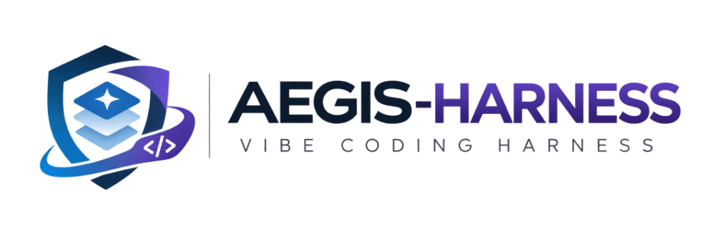

# Aegis Harness

**Aegis Harness** is a security-first and governance-first wrapper for AI-assisted coding. It sits between developers, coding models, and Git so that every model call, file change, and commit is policy-checked, logged to a tamper-evident audit chain, and emitted as telemetry to **Aegis**.

## Features Implemented

### Phase 1: Core Scaffold, Configuration, CLI & Audit Hash Chain
- **Local-First Git Workflow**: Initialises a local Git repository by default with an option to publish to GitHub (`https://github.com/ianloe/aegis-harness.git`).
- **Pydantic v2 Configuration Schema** (`src/harness/config/schema.py`): Validated `.harness/config.yaml` with human-readable parameter descriptions for form-based editing.
- **Tamper-Evident Audit Log** (`src/harness/audit/chain.py`): Append-only JSONL log with SHA-256 `prev_hash -> entry_hash` chaining, `harness audit verify` tamper detection, and HMAC-SHA256 signed daily checkpoints (`harness audit checkpoint`).
- **Local SQLite State Store** (`src/harness/audit/store.py`): Tracks tasks, active sessions, human approvals, telemetry queue, and checkpoints.

### Phase 2: Model Gateway
- **Provider-Agnostic Adapters** (`src/harness/gateway/adapters.py`): Supports Anthropic, OpenAI, Google Gemini, **Agnes AI** (`agnes-coder`), and OpenAI-compatible local endpoints (Ollama, vLLM).
- **Task & Classification Routing** (`src/harness/gateway/router.py`): Routes by task type (`plan`, `generate`, `refactor`, `review`, `test`), repository data classification (`restricted` repositories allow local or explicitly approved models only), USD cost ceilings, and ordered fallbacks.
- **Secret & PII Redaction** (`src/harness/gateway/redactor.py`): Scrubs API keys, tokens, private keys, emails, phone numbers, and NRIC/FIN numbers before outbound calls, logging only the redacted category.
- **Optional Encrypted Body Storage**: Stores prompt and response bodies encrypted with Fernet only when `store_prompt_bodies` is enabled.

### Phase 3: Policy Engine
- **Three Risk Tiers** (`low`, `medium`, `high`): Configurable in `.harness/config.yaml` with per-tier approval counts, diff-size caps, and required checks.
- **Policy-as-Code Evaluation** (`src/harness/policy/engine.py`): Evaluates model allow-lists, tool/command allow-lists, restricted file paths, diff size, and separation of duties (`approver != requester`), logging every `allow`, `deny`, and `require_approval` decision with `policy_version` and `reason`.
- **Sample Policy Profiles** (`policies/`): `strict-fintech.yaml`, `standard-enterprise.yaml`, and `sandbox-prototype.yaml`.

### Phase 4: Git Integration & Check-in Gates
- **Branch Isolation & Signed Commits** (`src/harness/gitops/workflow.py`): Blocks direct commits to `main`, enforces `agent/<task-id>` branches, requires SSH/GPG commit signatures, and appends AI provenance trailers (`Harness-Model`, `Harness-Provider`, `Harness-Task-ID`, `Harness-Policy-Version`, `Harness-Approver`).
- **Check-in Security Gates** (`src/harness/gitops/gates.py`): Runs secret scanning (`gitleaks` or built-in scanner), SAST (`semgrep` or built-in Python AST scanner), dependency/licence allow-list checks (`osv-scanner` + SPDX check), unit test & coverage threshold checks, and diff/path policy checks.
- **PR Summaries & Branch Protection**: Generates Markdown PR summaries (`harness pr`) and provides GitHub/GitLab branch protection guidance (`docs/BRANCH_PROTECTION.md`, `scripts/setup_github_branch_protection.sh`, `docs/ci/github-harness-gates.yml`).

### Phase 5: Telemetry & Mock Aegis Server
- **Pydantic & OpenTelemetry Standard** (`src/harness/telemetry/schema.py`, `src/harness/telemetry/exporter.py`): Emits `HarnessEvent` records as OpenTelemetry OTLP spans (`/api/telemetry/pydantic`), Aegis ingestion events (`/api/telemetry/ingest`), and MCP/A2A protocol events (`/api/telemetry/mcp-a2a`), with `Authorization: Bearer aegis_...` authentication.
- **Offline Queue & Idempotent Retry**: Queues events in SQLite (`telemetry_queue`) with idempotent `event_id` keys and exponential backoff so no events are lost or duplicated when Aegis is unreachable.
- **Editable FRAME & AAEF Mapping** (`config/frame_aaef_mapping.yaml`): Links every Harness event type to Aegis `FRAME` criteria and `AAEF` dimensions.
- **Governance Metrics** (`src/harness/telemetry/metrics.py`): Computes cost per task, tokens per task, check failure rate, human override rate, time to merge, AI-authored line percentage, and policy denials by type.
- **Mock Aegis Server** (`src/harness/telemetry/mock_aegis.py`): FastAPI mock server validated against Aegis's Zod contracts for local and CI testing.

### Phase 6: Agent Sandbox & Kill Switch
- **Isolated Execution** (`src/harness/sandbox/manager.py`): Runs agent commands in isolated Git worktrees (`agent/<task-id>`) or Docker containers with network disabled by default (`--network none`), CPU/memory caps, and allow-listed commands.
- **Prompt-Injection Defence** (`src/harness/sandbox/injection.py`): Scans repository content and comments for instruction overrides, guardrail-bypass attempts, and exfiltration directives, logging detections as `incident` events.
- **Least-Privilege Task Tokens** (`src/harness/sandbox/tokens.py`): Mints short-lived HMAC-signed per-task scoped tokens that are revoked immediately on kill switch activation.
- **Rapid Kill Switch** (`harness killswitch`): Terminates active sandboxed processes and containers within 5 seconds, revokes tokens, halts active sessions, and logs the event to the audit chain.

### Phase 7: Local Web Dashboard, Reporting & Configuration UI
- **Local Web Dashboard** (`harness dashboard`, `src/harness/dashboard/app.py`): Displays live and recent sessions, model usage and USD cost, gate results, pending human approvals (with inline approve action), and the policy decision feed.
- **Form-Based Configuration Webapp** (`/config`): Exposes `.harness/config.yaml` and three-tier risk policies as user-friendly forms with plain-English parameter explanations instead of raw JSON, validating and persisting updates back to YAML.
- **Built-in User Manual** (`/manual`): Interactive web guide covering local-first Git setup, model providers (including Agnes AI), risk tiers, daily workflow, audit verification, kill switch, and CLI reference.
- **CLI Governance Reporting** (`harness report`): Prints a summary table of task counts, USD cost, token usage, check failure rate, override rate, AI-authored line percentage, and audit chain verification status.

### Phase 8: Threat Model, Runbook, Docker Compose & Demo
- **STRIDE Threat Model** (`docs/THREAT_MODEL.md`): Maps spoofing, tampering, repudiation, information disclosure, denial of service, and elevation of privilege threats to Harness mitigations and Aegis telemetry signals.
- **Operator Runbook** (`docs/RUNBOOK.md`): Covers local-first Git setup, publishing to GitHub, daily developer workflow, kill switch incident response, audit verification, and offline telemetry recovery.
- **Docker Compose Deployment** (`Dockerfile`, `docker-compose.yml`): Packages the Harness dashboard and configuration UI for team deployment, connecting directly to Aegis (`https://aegisx.ianloehome.net`).
- **End-to-End Demo** (`scripts/demo.py`): Demonstrates model switching (Agnes AI), outbound secret redaction, secret gate blocking, two-person high-risk approval, mock Aegis OTLP telemetry, and audit chain verification.

## Quick Start

```bash
python3 -m venv .venv
.venv/bin/pip install -e ".[dev]"

harness init --name my-project --asset-code AI-004
harness task start "Add feature" --risk medium
harness model list
harness check
harness audit verify
```

## Running Tests

```bash
.venv/bin/pytest -v
```
